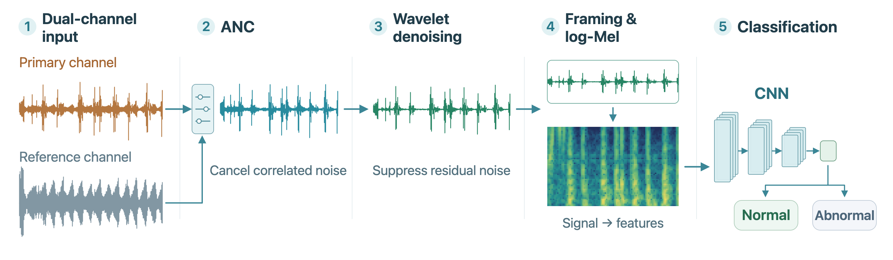
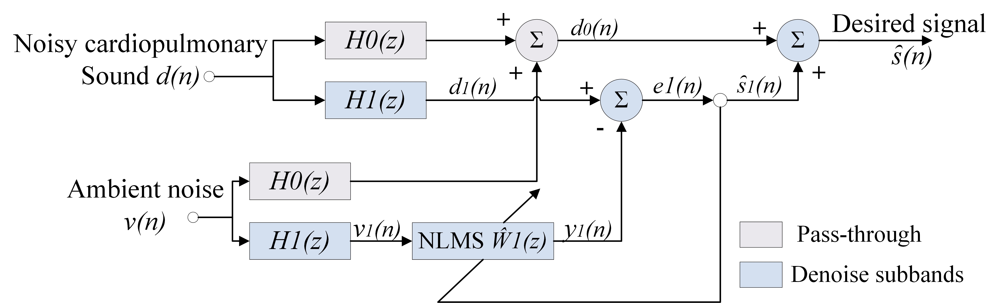
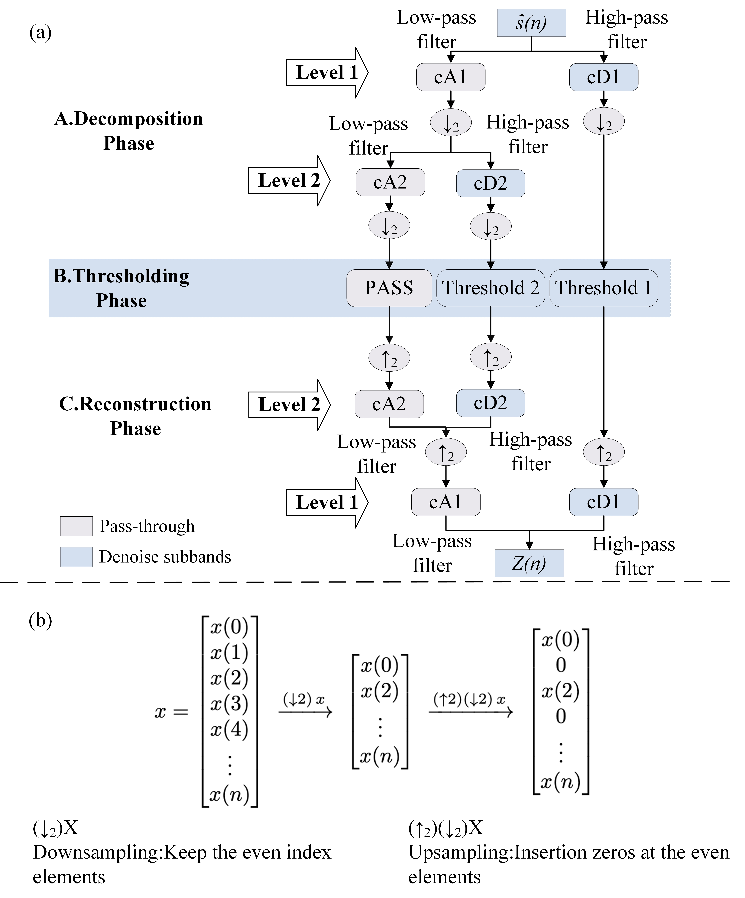
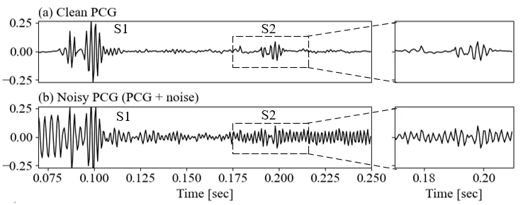
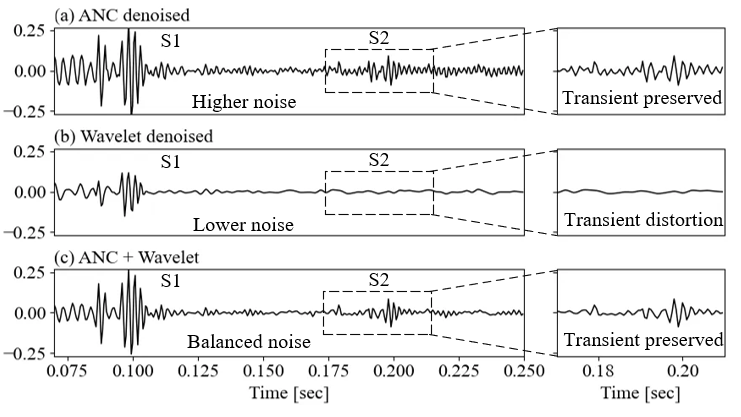
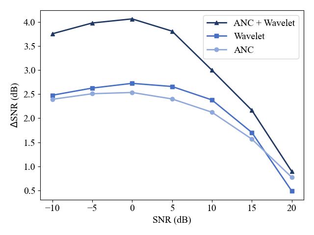
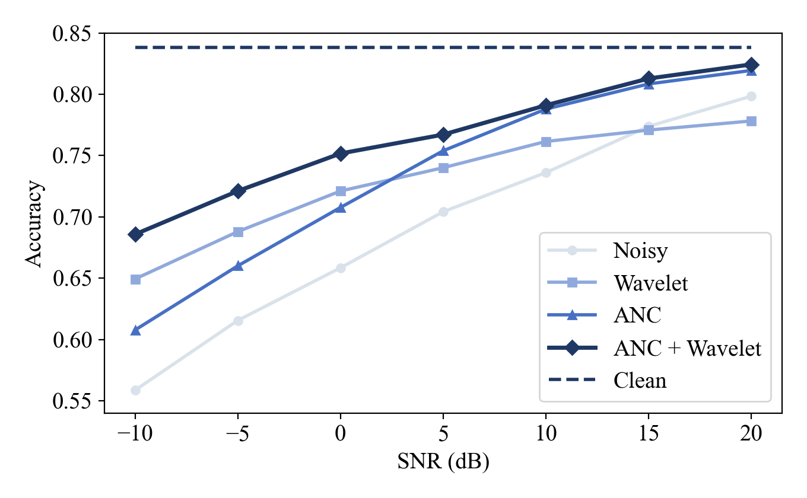
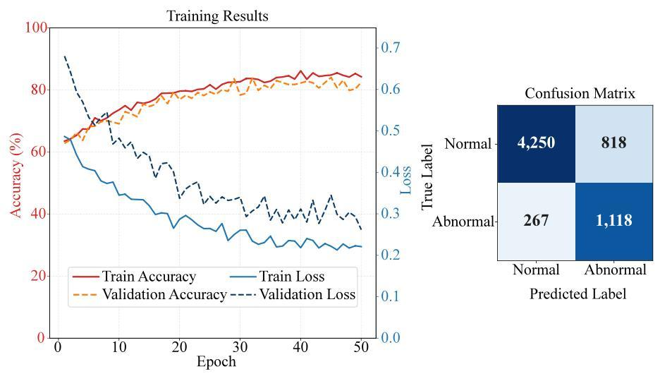

# Heart Sounds Through Noise

**English** | [简体中文](README.zh-CN.md)

**Dual-channel ANC and wavelet denoising for robust PCG classification.**

[TechRxiv preprint](https://doi.org/10.36227/techrxiv.177084814.40868704/v1) · [EMBC 2026 conference presentation](https://cmsworkshops.com/EMBC2026/view_paper.php?PaperNum=4350&SessionID=1053)

[Pipeline](#pipeline) · [Results](#results) · [Reproduction](#reproduction)

## TL;DR

Environmental noise can obscure heart sounds recorded by wearable devices. This project combines dual-channel adaptive noise cancellation (ANC), wavelet denoising, and a 622-parameter classifier to classify normal and abnormal heart sounds from noisy phonocardiogram (PCG) recordings.

- **Method:** Dual-channel subband ANC → wavelet denoising → log-Mel features → MicroHeartCNN with 622 parameters. Every denoising branch uses the same classifier.
- **Experiment:** PhysioNet/CinC 2016 heart sounds and MUSAN noise, sampled at 2 kHz. The 486 test recordings produce 6,737 segments. Six processing branches are compared at seven SNR levels from −10 to 20 dB.
- **Results:** Accuracy on clean inputs is **83.84%**. At −10 dB, ANC → Wavelet D1+D2 improves accuracy from **55.87% to 68.58%**, a gain of **12.71 percentage points**.

The repository includes preprocessing, training, evaluation and plotting code, along with baseline weights, fixed data splits and noise-mixing recipes.

## Pipeline



The experiment synthesizes the primary and reference channels from the same heart sound and noise recordings. The primary channel uses seven input SNR levels; the reference channel is fixed at −20 dB. Both channels contain heart sounds. Noise mixing and denoising operate on full recordings before they are divided into classification segments.

The classifier is trained without adding MUSAN noise to the training set, and its weights remain fixed during evaluation. The six branches are **Noisy, ANC, Wavelet D1, Wavelet D1+D2, Cascade D1 and Cascade D1+D2**. Cascade means ANC followed by wavelet denoising. D1 and D2 are the highest-frequency and second-highest-frequency detail levels, respectively.

### How denoising works

ANC estimates correlated noise from the reference channel and subtracts it from the primary channel. The residual signal updates the adaptive filter. Wavelet denoising decomposes the ANC output into multiple scales, applies soft thresholding to selected detail coefficients, preserves the remaining coefficients, and reconstructs the waveform.

**Subband ANC**



**Wavelet decomposition, thresholding and reconstruction**



### Waveforms before and after denoising

S1 and S2 denote the first and second heart sounds. The figure below compares clean and noisy heart sounds. Noise masks weaker transient details, especially in the enlarged S2 region on the right.



ANC cancels correlated noise using the reference channel, then wavelet denoising applies soft thresholding to detail subbands. In the example below, ANC alone preserves transient shapes but leaves residual noise. Wavelet denoising alone reduces background noise while also smoothing S2 details. The cascade reduces noise while preserving a clearer S2 waveform.



### Selecting wavelet subbands by SNR

The **ANC + Wavelet cascade** selects detail subbands for soft thresholding according to the input SNR:

| Input SNR in this experiment | Wavelet processing after ANC | Evaluation branch |
|---|---|---|
| −10, −5, 0, 5 dB | Soft thresholding of D1+D2 | `cascade_d1d2` |
| 10, 15, 20 dB | Soft thresholding of D1 only | `cascade_d1` |

Selection uses the input SNR specified when mixing the noise. Full evaluation retains results for both fixed configurations; the selected cascade results are read from the corresponding branch in the table above.

<details>
<summary>Full signal-processing parameters</summary>

**Segmentation and features.** Audio is converted to mono at 2,000 Hz. Each classification segment contains 6,000 samples, with a hop of 3,000 samples. Recordings shorter than 3 seconds are zero-padded on the right. For longer recordings, a final partial segment shorter than 3 seconds is discarded. Segment IDs, labels and data splits follow `manifests/segments.csv`.

| Parameter | Value |
|---|---|
| STFT | `n_fft=256`, `win_length=256`, periodic `hann` window, `hop_length=64` |
| Boundary handling | `center=True`, `pad_mode="constant"`, zero padding |
| Mel spectrogram | `power=2.0`, `n_mels=64`, `fmin=20`, `fmax=400` |
| Mel filter bank | `htk=False`, `norm="slaney"`, `dtype=float32` |
| Logarithm | `np.log(mel + 1e-6)`, natural logarithm, float32 output |
| Standardization | `(feature - mean) / std` for each Mel band, using training-set statistics |

**Noise mixing.** `manifests/noise_mixing.csv` fixes the noise file, start offset, cropping or looping rule, and target SNR. Noise recordings shorter than the heart sound are repeated to match its length. For heart sound `s`, noise `n` and target SNR `q`, the calculation uses float64:

```text
EPS = 1e-12
rms(x) = sqrt(mean(x*x) + EPS)
alpha = rms(s) / (rms(n) * 10**(q/20) + EPS)
mixed = float32(s + alpha*n)
```

The primary-channel SNR is −10, −5, 0, 5, 10, 15 or 20 dB, and the reference-channel SNR is −20 dB. Each channel is scaled separately. If its peak amplitude exceeds 0.98, the entire signal is scaled down proportionally before it is saved as PCM16.

**ANC and wavelets.** Primary-channel components below 250 Hz and above 900 Hz pass through unchanged. Adaptive filtering is applied separately to 250–400 Hz and 400–900 Hz. The ANC filter length is 512, with step sizes of 0.005 and 0.01 for the two processed bands, `leak=1e-5` and `delta=1e-6`. Delay alignment searches up to 120 samples. Wavelet denoising uses sym6, 4 decomposition levels, symmetric extension, universal soft thresholding with a threshold factor of 1.2, and reconstructed output clipped to ±0.98. D1 and D1+D2 process the highest one and two detail levels, respectively. Parameters are stored in `configs/experiment.json`.

</details>

## Results

### Denoising gain



The vertical axis, ΔSNR, measures the increase in SNR after processing. At low input SNRs, the cascade achieves a gain of approximately 3.8–4.1 dB. Cleaner inputs leave less room for further improvement.

### Classification under noise



The dark blue curve with diamond markers is **ANC + Wavelet**; the dashed line is the clean-input reference. The cascade achieves the highest accuracy at every tested SNR, with larger improvements at low SNRs.

### Classifier training



The left panel shows accuracy and loss over 50 training epochs. The right panel shows classification results for normal and abnormal heart sounds.

<details>
<summary>Experimental setup</summary>

| Item | Setting |
|---|---|
| Training / validation / test recordings | 2,268 / 486 / 486 |
| Training / validation / test segments | 30,664 / 6,277 / 6,737 |
| Training configuration | 50 epochs, batch size 32, learning rate 0.001, seed 42; model selected by validation accuracy |
| Fixed classifier | `heart_micro_20251230_184645`, 622 parameters |
| Clean-input results | Accuracy **83.8355%**, Macro F1 **81.6308%** |

</details>

<details>
<summary>Accuracy measured in the reproduction run</summary>

| Input SNR | Noisy | ANC → D1 | ANC → D1+D2 | Selected cascade |
|---:|---:|---:|---:|---:|
| −10 dB | 55.87% | 60.56% | 68.58% | **68.58%** |
| −5 dB | 61.56% | 65.99% | 72.11% | **72.11%** |
| 0 dB | 65.85% | 71.09% | 75.17% | **75.17%** |
| 5 dB | 70.42% | 75.51% | 76.71% | **76.71%** |
| 10 dB | 73.61% | 79.10% | 77.84% | **79.10%** |
| 15 dB | 77.38% | 81.28% | 78.45% | **81.28%** |
| 20 dB | 79.84% | 82.43% | 79.12% | **82.43%** |

The D1+D2 cascade provides larger gains at low SNRs, while the D1 cascade performs better at 10–20 dB. At 20 dB, the fixed D1+D2 configuration has slightly lower accuracy than Noisy. Metrics for all six branches are stored in `results/measured/full_denoising_metrics.json`.

</details>

### Comparison with the paper

| Item | Paper | This repository |
|---|---|---|
| Clean-input accuracy | 83.12% in the text | 83.8355% with the fixed weights |
| Test segments | 6,453 in Figure 4 | 6,737 |

## Reproduction

Follow **environment setup → data preparation → clean baseline → single-recording trial → full evaluation**. The baseline weights are included, so evaluation can run directly.

### 1. Set up the environment

After downloading or extracting the project, open a terminal in the project root containing `README.md`. The verified environment is **macOS ARM64, CPU, Python 3.9.6, PyTorch 2.8.0, NumPy 1.26.4 and librosa 0.11.0**. The commands below use a macOS/Linux shell; `python3` should point to a Python 3.9 interpreter.

```sh
python3 -m venv .venv
source .venv/bin/activate
python -m pip install -r requirements.txt
python -m pip check

DATA="/path/to/input_data"
RUN="/path/to/new_run"
```

Replace the placeholders with absolute paths. `DATA` holds input audio and `RUN` holds experiment outputs; neither directory may contain the other. For a first download, `DATA` must not already exist. Use a new `RUN` path for each experiment. The scripts create output subdirectories and result files. Run the remaining commands in the same terminal with the virtual environment activated.

`requirements.txt` includes the dependencies for preprocessing, denoising, training, evaluation and plotting. Install it once; the optional training step needs no additional dependency installation.

### 2. Prepare the data

**Heart sounds:** Use training-a through training-f from [PhysioNet/CinC Challenge 2016 v1.0.0](https://physionet.org/content/challenge-2016/1.0.0/). Download all 3,240 WAV files and verify their sizes and SHA-256 hashes:

```sh
python -m scripts.download_clean --output-root "$DATA"
python -m scripts.verify_inputs --data-root "$DATA" --kind clean
```

If a download is interrupted, wait for the original process to exit, then run `python -m scripts.download_clean --output-root "$DATA" --resume`. To use existing data, skip the download, arrange the files as shown below, and run verification directly.

**Noise:** Download and extract [MUSAN / OpenSLR 17](https://www.openslr.org/17/), then copy its `noise` directory to `$DATA/musan_noise`. This project uses 364 noise recordings from `free-sound` and `sound-bible`. Retain the source corpus's license and attribution files.

```text
input_data/
├── data/raw/
│   ├── training-a/*.wav
│   ├── training-b/*.wav
│   ├── training-c/*.wav
│   ├── training-d/*.wav
│   ├── training-e/*.wav
│   └── training-f/*.wav
└── musan_noise/
    ├── free-sound/*.wav
    └── sound-bible/*.wav
```

Verify the original noise files, then generate mono versions at 2 kHz:

```sh
python -m scripts.verify_inputs --data-root "$DATA" --kind noise
python -m scripts.prepare_noise --noise-root "$DATA/musan_noise" \
  --output-root "$DATA/musan_noise_2k"
python -m scripts.verify_inputs --data-root "$DATA" --kind noise_2k
```

`musan_noise_2k` must be a new directory. If verification fails, check the dataset version, files and paths. The heart sounds have been verified by downloading them again from the official source. Noise resampling has been verified using the retained original MUSAN files; a fresh download of the complete corpus has not yet been verified.

### 3. Reproduce the clean test baseline

```sh
python -m scripts.prepare_features --data-root "$DATA" \
  --output-root "$RUN/clean_features" --split test
python -m scripts.evaluate --data-root "$RUN/clean_features" \
  --output "$RUN/clean.json"
```

This generates features for 6,737 test segments and writes the results to `clean.json`. Baseline Accuracy is **83.8355%**, and Macro F1 is **81.6308%**. "Clean" means that no MUSAN noise has been added.

### 4. Try a single recording

Check the full pipeline with one heart sound recording at 5 dB:

```sh
python -m scripts.prepare_denoising --data-root "$DATA" \
  --output-root "$RUN/sample_waveforms" \
  --recordings training-f/f0015.wav --snrs 5
python -m scripts.evaluate_denoising --waveform-root "$RUN/sample_waveforms" \
  --output-dir "$RUN/sample_metrics"
```

This generates seven WAV files: the primary channel, the reference channel and five denoising outputs. `sample_metrics/metrics.json` and `predictions.csv` record metrics and segment-level predictions for the six classification branches.

### 5. Run full denoising evaluation and plot the results

```sh
python -m scripts.prepare_denoising --data-root "$DATA" \
  --output-root "$RUN/full_waveforms"
python -m scripts.evaluate_denoising --waveform-root "$RUN/full_waveforms" \
  --output-dir "$RUN/full_metrics"
python -m scripts.plot_results --metrics "$RUN/full_metrics/metrics.json" \
  --clean-result "$RUN/clean.json" --output-dir "$RUN/figures"
```

The outputs are **23,814 WAV files, 42 sets of classification metrics and 282,954 predictions**, plus PNG/SVG plots. Compare `full_metrics/metrics.json` with the repository's `results/measured/full_denoising_metrics.json` to check the complete results.

`scripts/plot_results.py` plots the six fixed branches. To summarize the selected cascade, read `metrics.json` by `snr` and `branch`: use `cascade_d1d2` at −10, −5, 0 and 5 dB, and `cascade_d1` at 10, 15 and 20 dB. The `accuracy` and `macro_f1` fields give the classification metrics for that condition.

<details>
<summary>Optional: retrain the classifier from raw audio</summary>

```sh
python -m scripts.prepare_features --data-root "$DATA" \
  --output-root "$RUN/all_features" --split all
python -m scripts.compute_normalization --data-root "$RUN/all_features" \
  --output-dir "$RUN/normalization"
python -m scripts.train --data-root "$RUN/all_features" \
  --norm_dir "$RUN/normalization" --output-dir "$RUN/training"
```

Standardization uses only the training set. Computing its statistics requires approximately 2 GiB of free memory. Training runs for 50 epochs on CPU by default, then evaluates that run's best model on the test set and writes results to `training/test_results.json`. The evaluation entry points `scripts/evaluate.py` and `scripts/evaluate_denoising.py` always use the repository's baseline weights. Training results may vary across environments.

</details>

## Citation and license

Jiaqi Zhang, Chenghao Yang, Chen Shen, Tiancheng Cao, and Hen-Wei Huang. “Noise-Robust Heart Sound Analysis for Wearable Monitoring Using Cascaded Dual-Channel ANC and Wavelet Denoising.” *TechRxiv*, preprint, 11 February 2026. DOI: [10.36227/techrxiv.177084814.40868704/v1](https://doi.org/10.36227/techrxiv.177084814.40868704/v1).

```bibtex
@misc{zhang2026noiserobust,
  author       = {Zhang, Jiaqi and Yang, Chenghao and Shen, Chen and Cao, Tiancheng and Huang, Hen-Wei},
  title        = {Noise-Robust Heart Sound Analysis for Wearable Monitoring Using Cascaded Dual-Channel {ANC} and Wavelet Denoising},
  year         = {2026},
  month        = feb,
  howpublished = {TechRxiv},
  note         = {Preprint, version 1},
  doi          = {10.36227/techrxiv.177084814.40868704/v1},
  url          = {https://doi.org/10.36227/techrxiv.177084814.40868704/v1}
}
```

Data sources: PhysioNet/CinC 2016, Liu et al., 2016, [DOI: 10.1088/0967-3334/37/12/2181](https://doi.org/10.1088/0967-3334/37/12/2181); MUSAN, [OpenSLR 17](https://www.openslr.org/17/).

Code, project documentation and project diagrams use the [MIT License](LICENSE). Baseline weights use [CC BY 4.0](licenses/LICENSE-WEIGHTS.txt). The algorithm diagrams, experimental result figures and waveforms are taken from Figures 2–8 of the authors' TechRxiv preprint and retain their [CC BY 4.0](https://creativecommons.org/licenses/by/4.0/) license. Data and dependencies retain their own licenses.

[Authors](docs/AUTHORS.md) · [Licensing scope](docs/LICENSING.md)
